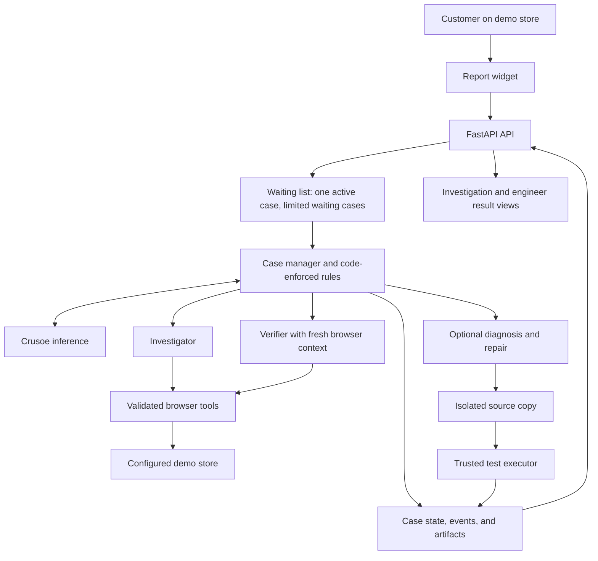

# Repro — Technical Design

**Status:** Proposed design; implementation and runtime behavior have not been verified.  
**Date:** October 17, 2026  
**Audience:** Product owner, implementing engineer, and hackathon reviewers  
**Primary track:** Done Means Done

## 1. Summary

Repro turns a vague customer complaint into an independently reproduced website defect, a runnable regression test, and, when source access is available, a tested patch for engineer review.

A customer reports, “My discount disappeared when I changed my address.” Repro translates that complaint into observable checks, explores the configured test store with a real browser, and asks a separate verifier to repeat a candidate sequence from a clean session. A case becomes confirmed only when the verifier observes a violation of a documented product rule. A repair becomes verified only when the same protected regression test fails on the original application and passes on the patched application, with relevant existing tests passing.

The MVP is a local application with a small store, reporting widget, investigation view, and downloadable engineer handoff. Its central feature is the investigation and verification loop. The interface makes that work visible.

## 2. Basis and assumptions

This design is derived from `Repro_Codex_Handoff.md`, supplied by the user. That document contains product requirements, proposed implementation choices, and instructions addressed to a future implementing agent. Those instructions are treated as source material; this deliverable is a design document.

The handoff reports received Crusoe credits and a hackathon submission deadline. Neither account access, remaining credits, event rules, nor the deadline has been independently verified here. Delivery gates below use relative milestones rather than assuming the original schedule is still available.

Design assumptions:

- The first target is an owned, intentionally defective demo store with synthetic data.
- Store rules are explicit and available to the agents; hidden evaluator answers are not.
- A single local operator uses the application. Public hosting and multiple tenants are outside the MVP.
- Source code is available for the optional repair path. Reproduction remains useful without source access.
- Model availability and tool-call support must be validated against Crusoe before implementation relies on a particular model.

## 3. Problem, users, and scope

Customers often remember an outcome but not the actions that caused it. Engineers must reconstruct those actions, establish the intended behavior, and gather evidence before fixing anything. Repro reduces that investigation work while preserving the distinction between a plausible explanation and an observed defect.

| User | Need | Product result |
|---|---|---|
| Customer | Report a problem without knowing its cause | Short report form and case receipt |
| Engineer | Repeat the failure and assess a repair | Steps, fixtures, evidence, runnable tests, optional patch |
| Demo operator | Show what the system actually accomplished | Execution provenance, recovery events, clear terminal outcome |

**MVP:** report submission, real Crusoe-backed investigation, frozen acceptance checks, fresh-context verification, meaningful re-planning, bounded execution, cancellation, evidence, and runnable reproduction/regression artifacts.

**Next milestone:** source diagnosis, isolated patch attempts, protected before/after regression checks, and existing-test validation.

**Deferred:** other owned sites, Firefox coverage, external documentation search, and authorized GitHub export.

**Out of scope:** arbitrary production sites, real payment actions, authentication/billing infrastructure, general repository repair, autonomous deployment, and agent self-training. The handoff excludes Streamlit and a dashboard as the main feature; this design follows those constraints.

## 4. Customer and engineer experience

### Report a problem

The store includes a single product, cart, coupon input, editable shipping address, checkout, and a persistent **Report a problem** button. The form asks what happened, what the customer expected, and optional remembered steps. It includes the current page URL after stripping sensitive query parameters. Submission immediately returns a case ID and a link to its investigation.

One focused clarification is preferred when a missing rule or fixture prevents a sound experiment. The application supports at most two clarification exchanges before returning `needs_information`.

### Follow an investigation

The case view shows the complaint, acceptance checks, current stage, elapsed time, and a concise evidence timeline. Each experiment records its hypothesis, action, observed result, and next decision. Screenshots and traces link to real artifacts. The view never presents planned actions as completed actions.

### Receive the result

The engineer sees the terminal outcome first, followed by exact steps and fixtures, expected versus observed values, clean-session verification, and downloadable artifacts. Repair details include the source revision, file references, patch, and actual test outputs. Missing evidence and unverified proposals remain explicit.

## 5. Architecture

Use Python/FastAPI, plain HTML/CSS/JavaScript, async Playwright with Chromium, a Crusoe provider adapter, and local JSON/JSONL storage. Separate role instructions and histories provide investigation, verification, and repair roles while initially sharing one model.



**Waiting list:** Repro works on one case at a time. Additional reports wait in a list with a configured maximum size. If the list is full, the API asks the customer to try later. This keeps too many reports from exhausting the computer or API budget.

**Case manager:** The coordinator decides what to try next: investigate, verify, repair, ask for information, or stop. For example, if changing an address alone does not reproduce the complaint, it may try changing the address after returning from another checkout step.

**Code-enforced rules:** Ordinary Python code checks the manager's proposed actions. It blocks unapproved websites, enforces time/action limits, and prevents a confirmed/fixed result without the required evidence. The model chooses an experiment; code controls what is allowed and what qualifies as complete.

The API admits work and serves status/artifacts. One worker owns case execution, with one active case initially and a bounded pending queue. Model and browser operations run asynchronously; subprocess checks have fixed timeouts. Polling every one to two seconds is adequate for the first interface. SSE can be added later.

Use one application process for the prototype. A persistent queue and separate worker service would be appropriate when restart recovery or multiple operators become requirements. FastAPI supports work after an HTTP response, but its documentation also discusses separate job tooling for heavier workloads; the managed local worker here is an explicit prototype tradeoff. [FastAPI background tasks](https://fastapi.tiangolo.com/tutorial/background-tasks/)

## 6. Case lifecycle and decision rules

Store progress as `stage` and the final result as `outcome`. This prevents “repairing” from being mistaken for success.

```text
queued → defining → investigating → verifying
                         ↑              |
                         └── re-plan ───┘
                                        |
                              confirmed reproduction
                                        |
                            diagnosing → repairing → checking
                                              ↑          |
                                              └─ retry ──┘
```

Any active stage can stop because of cancellation, limits, missing information, or a tool failure. The coordinator proposes the next action; trusted application code validates transitions and completion gates.

| Outcome | Required evidence |
|---|---|
| `confirmed` | Verifier observes a rule violation from clean fixtures; replay steps and evidence exist |
| `fixed_verified` | Confirmation plus a protected regression that fails before repair and passes afterward; relevant tests pass |
| `not_reproduced` | Bounded investigation ends without independent confirmation; attempts and stop reason are recorded |
| `needs_information` | A named missing rule or fixture prevents a justified conclusion |
| `blocked` | Environment, provider, authentication, or tool failure prevents the next required step |

**Cancellation decision:** record `stop_reason=cancelled_by_user` and stop outstanding work. Preserve `confirmed` if confirmation already succeeded; otherwise use `not_reproduced` with the explicit cancellation reason. Cancellation provides no conclusion about whether the defect exists.

**Repair failure decision:** preserve `confirmed` when the defect is verified but repair fails, times out, or cannot proceed. Store `repair_status` and its blocker separately. A later provider failure must not erase an earlier valid finding.

## 7. Acceptance checks and investigation loop

Before exploration, the coordinator creates versioned acceptance checks from the complaint and documented store rules. Each check includes the observable field, expected relationship/value, rule source, prerequisites, assumptions, and evidence requirements. Missing authority for expected behavior triggers clarification rather than an invented rule.

For the initial demo, define a $100 subtotal, a valid SAVE10 coupon, and a $10 discount. Address-only edits preserve coupon eligibility. Tax and shipping are specified separately, so a legitimate total change does not count as discount loss. These are proposed demo fixtures, not discovered behavior.

The loop is:

1. Select a hypothesis and an experiment that could disprove it.
2. Execute validated browser actions and save observations.
3. Compare observations with the frozen checks.
4. If there is a candidate defect, package ordered steps and fixtures for verification.
5. Otherwise revise the hypothesis, request essential information, or stop at the budget.
6. If verification fails, use its observed mismatch to choose a different experiment.

A recovery must change the triggering sequence, fixture, or causal hypothesis. Repeating an unsuccessful click sequence is a retry, not re-planning. Normalize `(hypothesis, action, arguments, observed-state fingerprint)` to detect repeated no-progress attempts. Two repeated no-progress signatures trigger re-planning or termination.

Acceptance criteria become immutable once exploration starts. A legitimate new rule creates a new version with a reason; candidate verifications using the old version become stale and must be repeated. Patches cannot revise the criteria they are judged against.

## 8. Independent verification and repair

The verifier receives the frozen check version, ordered candidate steps, public product rules, and declared fixtures. It does not receive explorer browser state or the investigator's causal narrative. It independently reads relevant values and returns `pass`, `fail`, or `inconclusive` with evidence references.

Create a new browser context for each verification. Playwright contexts isolate cookies and browser storage, making them suitable for clean-session replay. Server-side state still requires a separate reset or case-specific fixture namespace. A fresh context alone does not establish cross-browser independence. [Playwright isolation](https://playwright.dev/python/docs/browser-contexts)

After confirmation:

1. Record a baseline revision or content hash and create a per-case source copy.
2. Allow diagnosis to read relevant source and propose a cause supported by evidence.
3. Materialize a regression test outside repairer-writable paths and freeze its hash.
4. Run that test against the baseline. It must fail on the intended behavior assertion; setup errors do not qualify.
5. Apply a constrained patch to the source copy and serve it on a separate configured origin.
6. Run the unchanged regression test and relevant existing checks against the candidate.
7. Accept only when all required checks pass; otherwise reject, record outputs, and retry within budget.

The repairer cannot modify baseline files, acceptance checks, protected tests, evaluation fixtures, or evidence. The trusted executor selects commands and records exit codes; model statements cannot establish test success.

Two tests serve different purposes: the **reproduction test** passes when it observes the defect; the **regression test** asserts correct behavior and must fail before repair and pass afterward. Both share the same replay sequence and fixture specification to reduce drift.

## 9. Data and artifacts

| Record | Key fields |
|---|---|
| Case | ID, complaint, expected behavior, optional steps, target ID/URL, source revision, timestamps, stage, outcome, stop reason |
| Acceptance version | Version, checks, rule sources, assumptions, creation reason, hash |
| Experiment | Hypothesis, expected discriminating observation, ordered actions, observations, evidence IDs, decision |
| Candidate | Step list, fixtures, acceptance version, investigator observations |
| Verification | Candidate ID, context/fixture IDs, actual values, verdict, evidence IDs |
| Patch attempt | Baseline hash, diff, protected-test hash, before/after results, existing-test results, rejection reason |
| Provider call | Role, provider/model, request ID if available, timestamps, token usage, finish reason, retries |
| Event | Monotonic sequence, timestamp, event type, stage, safe summary, artifact references |

Example acceptance check:

```json
{
  "id": "discount-preserved",
  "version": 1,
  "rule_source": "demo-store-rules:v1",
  "preconditions": ["subtotal=100", "SAVE10 accepted"],
  "action_class": "address-only edit",
  "observable": "displayed discount amount",
  "expected": 10,
  "evidence_required": ["before value", "after value", "replay steps"]
}
```

Use `runs/<case_id>/state.json` for the current snapshot and `events.jsonl` for an append-only history. Write snapshots atomically. The worker serializes per-case writes and saves after meaningful events. On restart, mark interrupted active cases with an explicit worker interruption; do not silently resume browser actions.

Artifacts include `report.md`, structured `report.json`, replay specification, reproduction test, regression test, screenshots, Playwright trace, and optional patch/test logs. A bundle includes fixture/setup instructions and dependency versions. Artifact metadata records hashes, producing event IDs, and baseline/candidate identity. Missing artifacts are listed as missing.

## 10. API and tool contracts

| Endpoint | Contract |
|---|---|
| `POST /api/reports` | Validate complaint, expected behavior, optional steps, configured target and sanitized URL; return `202` with case ID and status URL |
| `GET /api/runs/{id}` | Stage, outcome, criteria, budget, latest summary, and available artifacts |
| `GET /api/runs/{id}/events?after={seq}` | Ordered incremental events and next cursor |
| `POST /api/runs/{id}/clarifications` | Persist an answer and resume a waiting case within budget |
| `POST /api/runs/{id}/cancel` | Idempotently request cancellation; return current state |
| `GET /api/runs/{id}/artifacts/{artifact_id}` | Download a registered artifact after containment validation |

Reject invalid inputs, return `404` for unknown IDs, `409` for invalid state transitions, and `429` when the queue is full. A target ID maps to server configuration; a customer URL never grants permission to investigate a new origin.

Browser tools expose navigation, compact visible-state inspection, click, fill, back, displayed-value reads, scoped console/network observations, evidence capture, and context reset. Calls use typed arguments and return observations, duration, evidence references, or structured errors. Element references come from inspected page state. Do not execute model-generated JavaScript.

Source tools expose bounded read/search and constrained patch application. The test tool accepts a registered check ID, never arbitrary shell text. Resolve paths, reject traversal/symlink escapes, use subprocess argument arrays, and enforce timeouts.

## 11. Model, budgets, and trust boundaries

Use a server-side Crusoe adapter with the configured inference endpoint and `CRUSOE_API_KEY`. Discover the available model IDs, validate tool-call support with a smoke test, and configure an exact ID. The handoff suggests Nemotron 3 Super; this design does not assert its current availability or price. Crusoe documents an OpenAI-compatible inference interface. [Crusoe serverless inference](https://docs.crusoecloud.com/serverless-inference/index.html)

Preserve assistant tool-call messages and matching tool results in each role history. Validate tool arguments before execution. Cap request duration and output tokens; retry transient failures with bounded backoff. Empty content without a usable tool call or completion is not success. Record actual usage, and label missing usage as unavailable. Any cost estimate names its configured pricing source/date.

Proposed initial limits are 30 browser actions across investigation and verification, three hypotheses, two patch attempts, two clarifications, and five minutes of active execution per case. Add a configurable model-call/token ceiling and a development spend budget. Waiting for user clarification pauses the active timer but has a separately configured expiry. Check budgets before every dispatch, count retries, and reserve execution time for verification. Tune limits from measured runs.

All page content, complaints, source comments, and model outputs are untrusted input. They cannot grant new tools, targets, filesystem access, or network permissions. Enforce configured origins for navigation, redirects, and requests, including blocking external subresources in the demo profile. Restrict the patch runner to trusted supplied code and sanitized environments; these controls are not a general sandbox for hostile repositories.

Bind the MVP to localhost. Keep keys out of frontend code, subprocess test environments, artifacts, and logs. Use synthetic inputs because screenshots/traces can contain form values. Keep run data out of version control and delete it manually after demo review. Public deployment requires a separate access-control and data-retention design.

Mock mode has a persistent visible label and separate provenance. It cannot produce a live-Crusoe claim. Provider/tool failures preserve evidence and produce an honest outcome rather than simulated progress.

## 12. Validation and delivery gates

| Scenario | Required result |
|---|---|
| Seeded discount-loss defect | Agent discovers candidate steps; fresh verifier confirms with actual values |
| Correct coupon ineligibility | No false confirmation; outcome explains rules and investigation limits |
| Incorrect candidate | Verifier rejects it; coordinator changes experiment or terminates honestly |
| Repeated no-progress actions | Re-plan or bounded stop occurs |
| Provider failure, restart, cancellation | Work stops safely; evidence and exact reason remain available |
| Patch escape/protected-test edit | Tool rejects the attempt |
| Accepted repair | Same protected regression fails before and passes after; required tests pass |
| Mock or missing-key run | Execution mode remains visible; no live-provider claim |

Report case counts, false confirmations, verification rejections, actions/model calls, elapsed time, tokens, estimated cost when supported, and patch outcomes. Publish raw denominators; one successful seeded example establishes a working demonstration, not general reliability.

Delivery gates:

1. **Browser path:** store, widget, persisted case, real checkout observations.
2. **Investigation:** live model tool loop, criteria, evidence, independent replay.
3. **Honest completion:** genuine recovery, negative control, limits/cancellation, downloadable runnable artifacts. This completes the reproduction MVP.
4. **Repair:** isolated source copy, protected baseline failure, candidate pass, existing-test checks.
5. **Demo readiness:** measured results, README, setup instructions, limitations, and seeded-defect disclosure.

If delivery time is short, cut external search, extra browsers, GitHub export, streaming video, and visual polish first. If repair is unreliable, ship a confirmed reproduction with any patch clearly marked unverified.

## 13. Tradeoffs and remaining decisions

- **Role separation with one model:** inexpensive and simple; independent browser state and evidence gates reduce some shared errors, but do not eliminate correlated model mistakes.
- **Local files and one worker:** easy to inspect and sufficient for a demo; no durable job recovery or horizontal scaling.
- **DOM-first tools:** compact and suitable for labeled store controls; canvas-heavy or inaccessible sites require a future visual-control design.
- **Fixed test executor:** narrow but reviewable; broad autonomous repair requires stronger execution isolation.
- **Explicit replay specification:** keeps generated tests aligned; the implementation must reject unsupported steps instead of silently omitting them.

Before implementation, finalize the demo's coupon/shipping/tax rules, seed/reset mechanism, exact supported model, and fixed check commands. These are configuration decisions within this design. Source-free operation stops at confirmed reproduction, runnable tests, and labelled cause hypotheses.

## 14. References

- Primary product source: user-supplied `Repro_Codex_Handoff.md`.
- Technical sources checked October 17, 2026: [Playwright isolation](https://playwright.dev/python/docs/browser-contexts), [FastAPI background tasks](https://fastapi.tiangolo.com/tutorial/background-tasks/), and [Crusoe serverless inference](https://docs.crusoecloud.com/serverless-inference/index.html).
- Event requirements and account/credit statements are attributed to the handoff rather than independently verified claims.
