# Repro architecture

The coordinator owns the case lifecycle. It gives a Crusoe model typed experiment/browser tools, frozen public-rule criteria, and bounded budgets. The model can propose actions and candidates; ordinary code owns queue admission, tool validation, artifacts, cancellation, and terminal outcomes.

The trusted policy check is the independent verifier. It uses a new Chromium instance/context and a registered read-only DOM adapter, replays actual saved steps, and compares visible coupon/totals against the versioned store rule. It never accepts the model's claim of success as proof. Unsupported or incomplete replay is inconclusive.

The bounded local queue means one case runs at a time and at most five wait. The next case starts when the worker is free. Duplicate submissions for an active case are rejected. This fits the local hackathon prototype; it is not a distributed job system.

```mermaid
flowchart LR
  Widget[Report widget] --> API[FastAPI + durable case store]
  API --> Queue[1 worker / 5 waiting]
  Queue --> Investigator[Crusoe investigator]
  Investigator --> Browser[Typed isolated browser tools]
  Browser --> Evidence[Observed DOM / screenshots / traces]
  Evidence --> Candidate[Candidate + frozen checks + actual steps]
  Candidate --> Verifier[Independent clean-session policy check]
  Verifier -->|violation observed| Confirmed[confirmed]
  Verifier -->|incomplete or no violation| Stop[blocked / not reproduced]
  Confirmed --> Repair[Optional bounded Crusoe repair]
  Repair --> Copy[Candidate store.js only]
  Copy --> Gate[Identical protected baseline / candidate checks]
  Gate -->|baseline fails / candidate and controls pass| Fixed[fixed_verified in isolated copy]
  Gate -->|rejected or interrupted| Confirmed
  API --> Handoff[Reports / replay / tests / hashes / patch / proof]
```

The synthetic store uses browser-local state; it has no shared cart database to reset. FastAPI serves both target and service for the demo, while browser request guards prevent the agent from using service mutation endpoints or foreign origins. This arrangement is loopback-only and has no authentication/multi-tenant isolation.

The repairer can inspect source only after independent confirmation. It has no shell or arbitrary file-write tool. The host freezes its fixture/checks, sanitizes child environments, verifies source/check hashes, and captures actual process outputs. A successful isolated repair never changes the original seeded demo.

Case JSON and JSONL events live under ignored `runs/`; original screenshots, traces, check receipts, repair copies, and exports share contained case directories. `.env` is read only by local provider settings. The browser receives execution labels and provenance, never the credential. Source, evaluator tests, and the operator guide are excluded from investigator input.
